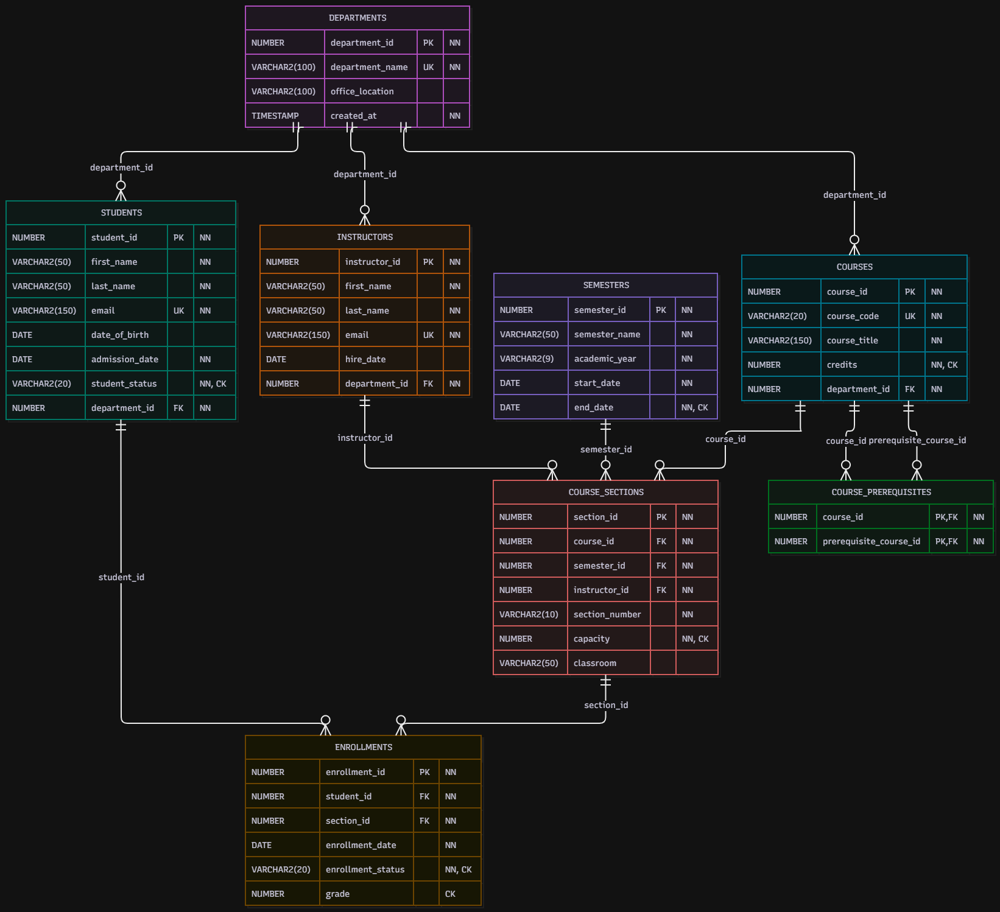

# University Management System

A relational database project developed using Oracle SQL and PL/SQL to manage university academic operations.

## Entity Relationship Diagram (ERD)

The diagram illustrates the database entities, attributes, primary keys, foreign keys, and relationships.

**Editable diagram:** [er_diagram.drawio](docs/er_diagram.drawio)

## Database Entities

The database consists of eight main tables:

- Departments
- Students
- Instructors
- Courses
- Course Prerequisites
- Semesters
- Course Sections
- Enrollments

## Technologies

- Oracle SQL
- PL/SQL
- Oracle APEX
- Draw.io

## Project Features

- Relational database design
- Primary and foreign key constraints
- Data validation using UNIQUE, NOT NULL, and CHECK constraints
- SQL queries, joins, subqueries, and common table expressions
- Aggregate and window functions
- PL/SQL procedures, functions, cursors, and exception handling
- Transactions and triggers
- Views and reporting queries
- SQL test scripts

## Project Structure

- `docs/` — Requirements, business rules, and ER diagram
- `database/01_schema/` — Table creation and constraints
- `database/02_data/` — Sample data
- `database/03_queries/` — SQL queries
- `database/04_plsql/` — PL/SQL programs
- `database/05_views/` — Database views
- `database/06_reports/` — Reporting queries
- `tests/` — Database test scripts

## Purpose

This project demonstrates practical skills in relational database design, SQL querying, PL/SQL programming, and database validation.